# Awesome-Edtech-Personalized-AI-Tutoring


  





  
  
  
  
  



# 🧠 Top EdTech & Personalized AI Tutoring

**Curated List of SaaS Products & Open-Source GitHub Projects**  
*Focused on Socratic AI Tutors, Step-by-Step Math/STEM Solvers, Adaptive Spaced-Repetition, AI Speech Coaches & Self-Hosted Study Companions*  
**Last updated: November 2026**

This repository tracks notable **SaaS platforms** and **open-source projects** for **EdTech & Personalized AI Tutoring**. These tools power Socratic conversational tutoring, camera/OCR step-by-step math and science problem solving, adaptive flashcard scheduling, real-time language pronunciation coaching, and self-hosted AI study assistants for students, educators, and lifelong learners.

**Examples** include Duolingo, Quizlet, Brainly, Course Hero (Learneo), Chegg Study, Khan Academy (Khanmigo), Photomath (Google), ELSA Speak, Symbolab, and Socratic by Google (the category leaders).

**🚀 Open-source emphasis**: This section is heavily expanded with every major active project for open-source AI tutoring agents, symbolic math engines, OCR equation solvers, adaptive spaced-repetition schedulers, and local RAG study companions — ideal for students, educators, and EdTech engineers building privacy-first tutors without recurring homework-help subscriptions.

🤝 Contributions welcome! Open a PR to add/update entries. Keep descriptions factual and link to official sites.

## 📑 Table of Contents
- [📊 Sector Overview & Market Dynamics](#-sector-overview--market-dynamics)
- [☁️ SaaS/Hosted Platforms](#️-saashosted-platforms)
- [💻 Open-Source GitHub Projects](#-open-source-github-projects)
- [🛠️ How to Contribute](#️-how-to-contribute)
- [⚠️ Disclaimer](#️-disclaimer)
- [💖 Support & Thank You](#-support--thank-you)

## 📊 Sector Overview & Market Dynamics

The global EdTech market is valued at approximately **$213B–$215B in 2026**, while the **AI Tutoring & Personalized Learning** segment accounts for roughly **$9.6B–$11.4B in 2026** and is growing at a ~26%–35% CAGR toward $57B+ by 2033. The market is **moderately fragmented** across subject-specific STEM solvers, K–12 homework support, and language coaching—with legacy paywalled Q&A models facing sharp disruption from generative AI—while consumer language and flashcard platforms exhibit **winner-take-most concentration** around Duolingo, Quizlet, and Khanmigo.

## ☁️ SaaS/Hosted Platforms

*Sorted descending by company valuation / annual revenue scale.*

| Platform | Description | Company Scale (Valuation / Revenue) | Starting Paid Tier | Free Tier / Trial Limit |
| :--- | :--- | :--- | :--- | :--- |
| **[Duolingo](https://duolingo.com)** | Gamified language, math, and music tutor featuring Duolingo Max generative AI roleplay, video calls, and personalized answer explanations. | **$5.70B Valuation** ($1.04B FY2025 revenue) | **$12.99/mo** (or ~$84–$96/yr for Super Duolingo; Max ~$29.99/mo) | **Forever Free** (All courses + Explain My Answer, ad-supported with daily Energy cap; 7–14 day Super trial) |
| **[Quizlet](https://quizlet.com)** | AI-enhanced study platform offering adaptive flashcards, Q-Chat Socratic tutoring, magic notes, and personalized practice tests. | **~$1.00B Peak Valuation** (~$150M+ est. annual revenue) | **$7.99/mo** (or **$35.99/yr** billed annually for Quizlet Plus) | **Forever Free Basic Plan** (Standard flashcard creation/study with ads, capped AI Q-Chat/Magic Notes prompts; 7-day Plus trial) |
| **[Course Hero (Learneo)](https://coursehero.com)** | Online study platform offering AI homework help, step-by-step textbook solutions, and course-specific tutoring documents. | **~$600M–$800M Group Revenue** (Part of Learneo; $3.6B peak valuation) | **$9.95/mo** billed annually ($119.40/yr) or **$39.95/mo** monthly | **Forever Free Basic Access** (Blurred document previews + limited AI questions/unlocks earned via document uploads; no open 7-day full unlock) |
| **[Brainly](https://brainly.com)** | Peer-to-peer and AI-moderated homework help network providing instant step-by-step explanations across K–12 and college subjects. | **~$500M–$600M Est. Valuation** (~$80M+ est. annual revenue) | **$12.00/mo** billed semi-annually ($72/6 mos) or **$18.00/mo** monthly | **Forever Free Ad-Supported Tier** (Limited daily community/AI answers with video ads and daily question caps; 7-day Brainly Plus trial) |
| **[Chegg Study](https://chegg.com)** | Academic support platform providing automated AI step-by-step homework solutions, textbook walkthroughs, and exam prep. | **~$450M–$550M Annual Revenue** (~$150M–$250M public market cap) | **$14.95/mo** for Chegg Study (or **$19.95/mo** for Chegg Study Pack) | **Limited Free Sample Solutions** (1–2 blurred/preview AI explanations per session; requires paid subscription for full step-by-step access) |
| **[Khan Academy & Khanmigo](https://khanacademy.org)** | Non-profit mastery learning platform powered by Khanmigo, a GPT-based Socratic tutor that guides students without giving away answers. | **$117.5M Annual Revenue** (FY2024–2025 501(c)(3) nonprofit filings) | **$4/mo** (or **$44/yr** for learners/families covering up to 10 child accounts) | **Forever Free** (100% of core courses/exercises free forever; Khanmigo AI free for verified teachers in supported regions) |
| **[Photomath (Google)](https://photomath.com)** | Camera-based math solver scanning handwritten and printed equations to deliver animated, step-by-step algebraic and calculus explanations. | **Acquired by Google** (~$50M–$100M+ pre-acquisition valuation; >300M downloads) | **$9.99/mo** (or **$69.99/yr** for Photomath Plus animated tutorials) | **Forever Free Core Solver** (Unlimited camera equation scanning and basic step-by-step text solutions; 7-day Plus trial) |
| **[ELSA Speak](https://elsaspeak.com)** | AI-powered English pronunciation and speech coach analyzing phoneme-level voice input with personalized daily speaking lessons. | **~$100M+ Est. Valuation** (~$20M+ est. ARR; backed by Google Gradient) | **$11.99/mo** (or **~$69.99–$89.99/yr** for ELSA Pro; Premium ~$14.99/mo) | **Forever Free Basic Plan** (Up to 5 free pronunciation lessons/day and initial speech assessment; 7-day Pro/Premium trial) |
| **[Symbolab (Learneo)](https://symbolab.com)** | Automated symbolic math calculator and AI tutor solving algebra, calculus, trigonometry, and differential equations step by step. | **Part of Learneo** (~$15M–$25M standalone acquisition scale) | **$9.99/mo** (or **$39.99/yr** billed annually for Symbolab Pro) | **Forever Free Calculator** (Final answers and first-step hints free; full intermediate steps & practice quizzes require Pro) |
| **[Socratic by Google](https://socratic.org)** | Free mobile AI homework companion using Google visual recognition and knowledge graphs to explain math, science, and literature concepts. | **Google Product** (Subsidized consumer EdTech app) | **$0 / Free** (No paid subscription tier) | **100% Free Forever** (Unlimited photo/voice homework queries, concept explainers, and curated study guides) |

## 💻 Open-Source GitHub Projects

| Project | License / Hosting Cost | Free Tier / Self-Hosted Limit | Description |
| :--- | :--- | :--- | :--- |
| **[DeepTutor (`HKUDS/DeepTutor`)](https://github.com)** | **MIT Open-Source** ($0 self-hosted; bring-your-own LLM API keys or Ollama models) | **100% Free forever** (Unlimited personalized tutoring sessions, adaptive knowledge tracing, and multi-agent study workflows locally) | HKUDS's open-source personalized AI tutoring system combining knowledge-graph reasoning, Socratic dialogue, and adaptive learner modeling. |
| **[SymPy (`sympy/sympy`)](https://github.com)** | **BSD-3-Clause Open-Source** ($0 Python symbolic math library) | **100% Free forever** (Unlimited symbolic algebra, calculus, equation solving, and LaTeX step rendering on local hardware) | Pure-Python computer algebra system powering open-source step-by-step math solvers (such as SymPy Gamma) as an alternative to Symbolab. |
| **[Texify (`VikParuchuri/texify`)](https://github.com)** | **GPL-3.0 Open-Source** ($0 local vision-OCR model) | **100% Free forever** (Unlimited camera/screenshot math equation to LaTeX conversions on local CPU/GPU) | Open-source mathematical OCR model converting images of handwritten or printed equations into clean LaTeX—the vision core behind open Photomath clones. |
| **[LaTeX-OCR / Pix2Tex (`lukas-blecher/LaTeX-OCR`)](https://github.com)** | **MIT Open-Source** ($0 local Vision Transformer model) | **100% Free forever** (Unlimited screenshot-to-LaTeX formula recognition locally with GUI and Python API) | Lightweight Vision Transformer tool that converts images of mathematical formulas into editable LaTeX code for automated STEM tutoring pipelines. |
